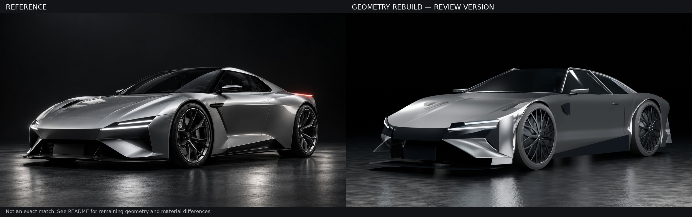

# VELOC geometry reconstruction — review version 3

Continued geometry refinement against the supplied silver-car reference. **This is still not an exact reproduction or an approved final asset.**

## Downloads

- [Editable Blender scene](veloc-body-v3.blend)
- [Car GLB](veloc-body-v3.glb)
- [Car FBX](veloc-body-v3.fbx)
- [Full-resolution render](veloc-body-render.png)
- [Reference comparison](comparison.jpg)

## Changes from version 2

- Reworked side-panel curvature independently of the wheel openings, removing the compressed, rippled fender transitions.
- Replaced the square front intake surrounds with recessed ducts, four-sided curved bumper ribbons fitted to the reference view, and outer surfaces that blend into the fenders.
- Flattened the outer front edge, fitted the unequal LED lengths and slopes to the reference, and added small modeled hood creases.
- Rebuilt the cabin profiles, curved rear pillars, black front pillars, and mirrors. Added physically transmissive glazing, a cabin aperture, dashboard, seats, headrests, and steering wheel.
- Replaced round wire-like wheel spokes with solid flat split spokes, modeled lower-profile tires, lowered the arch openings and fender crests, and corrected reversed surface normals on tires and bumper panels.
- Reduced the side vents, raised the lower door crease, conformed the door seams to the panels, added tapered mirror housings and rear wraparound lights, and adjusted studio reflections.

The Blender file preserves independently editable geometry, curves, materials, collections, studio lighting, and a reference-view camera. The GLB and FBX contain the static car without the studio. Blender 5.2.2 LTS was used. The render is 1672 × 941, Cycles, 128 samples with denoising.

## Remaining differences

The hood and fender contours, bumper-wing shapes, canopy outlines, door surfacing, wheels, and lighting still differ visibly from the reference. This is a procedural approximation, not the original car's CAD model. Front-panel joins and underside closure remain unfinished. Some panels are open surface meshes rather than a single watertight body. Hidden rear, underbody, and interior details are inferred from a single view. The asset has not yet been optimized for real-time web use.

`build_car.py` reconstructs the editable scene. `render_export.py` builds it, renders it, and exports GLB/FBX. `verification.json` records the separate reopen/render and GLB import checks. Version 2 remains in the adjacent `veloc-body-v2` folder.
